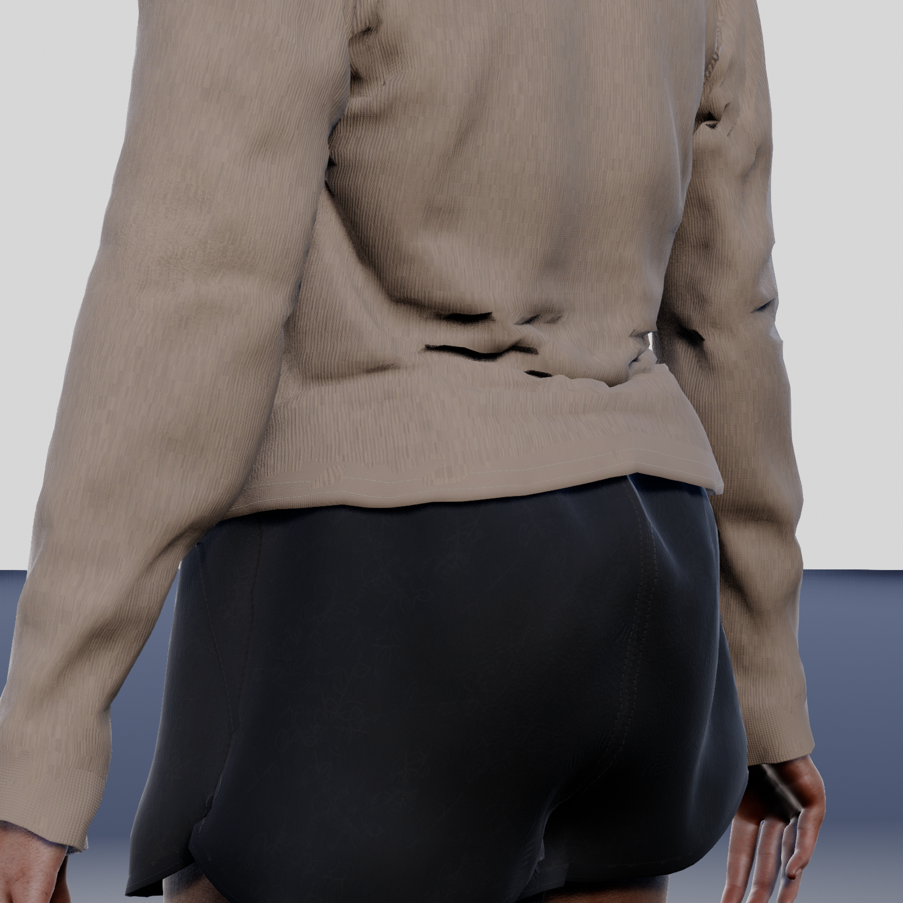
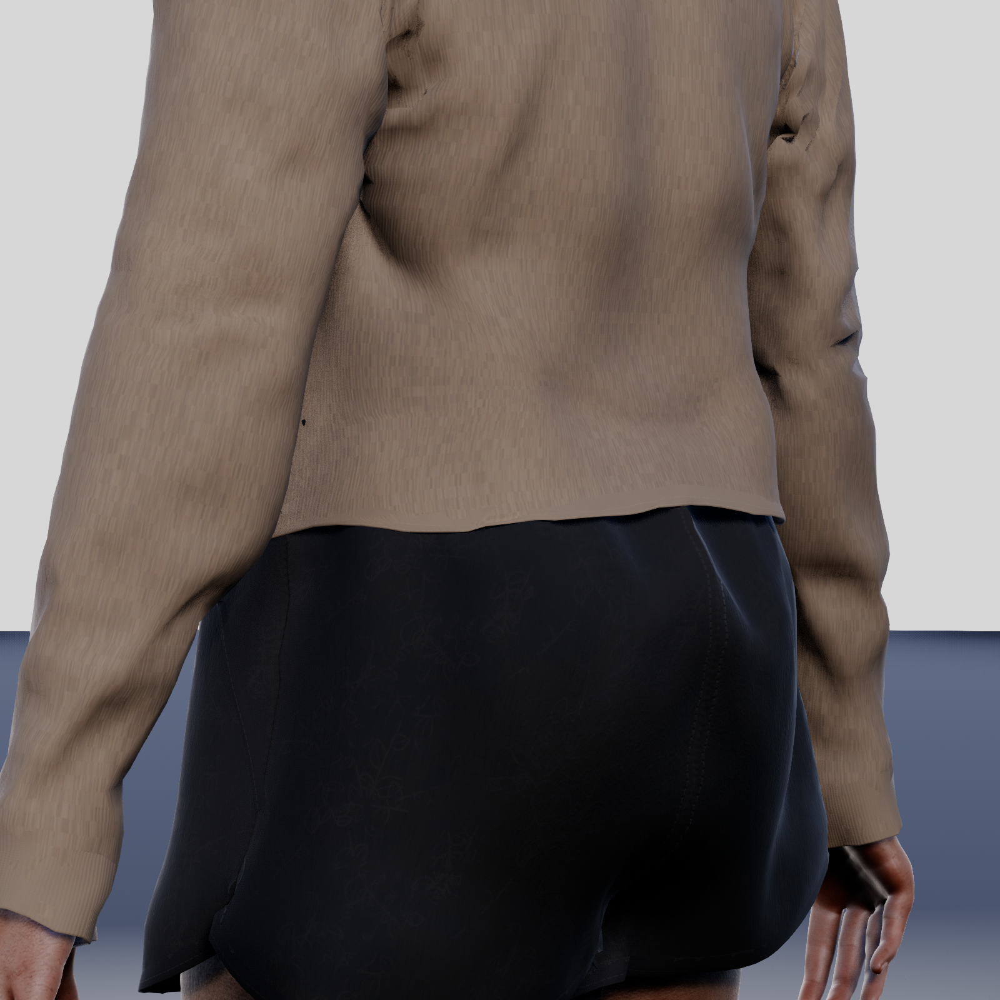
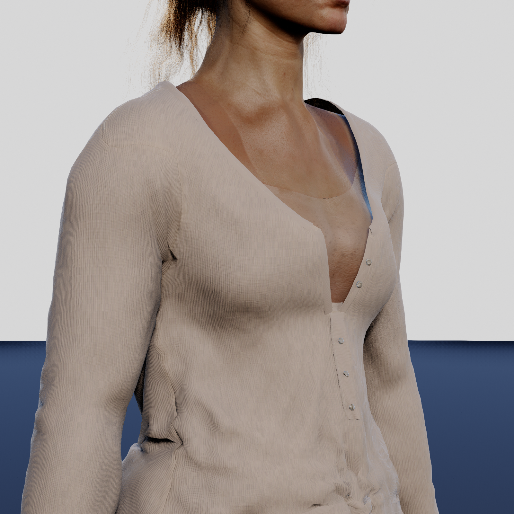
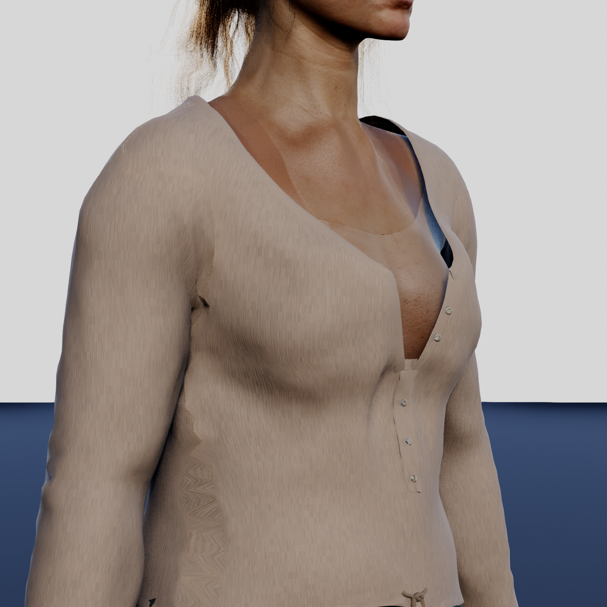
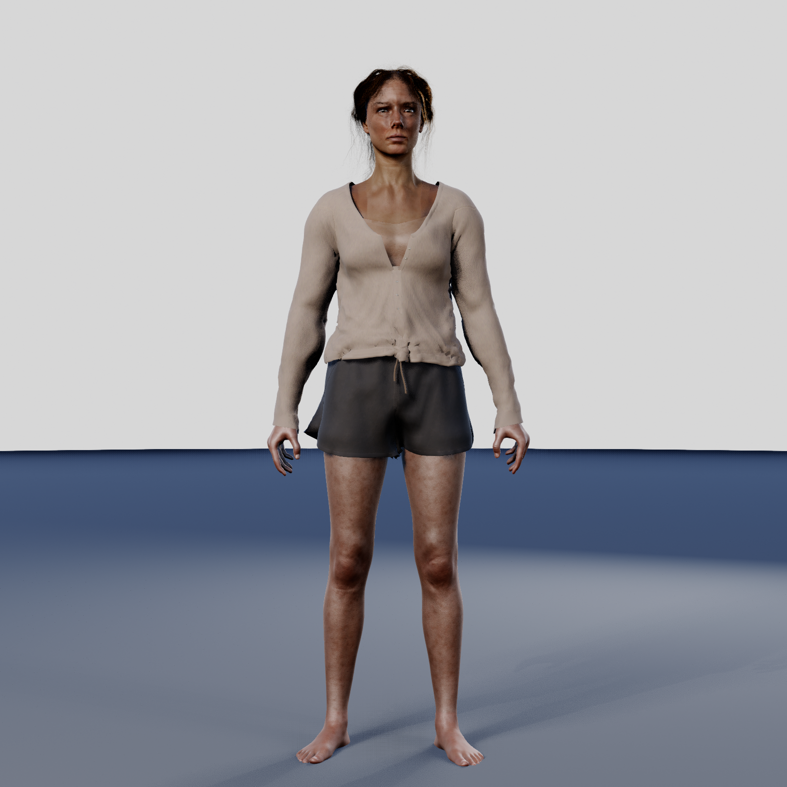
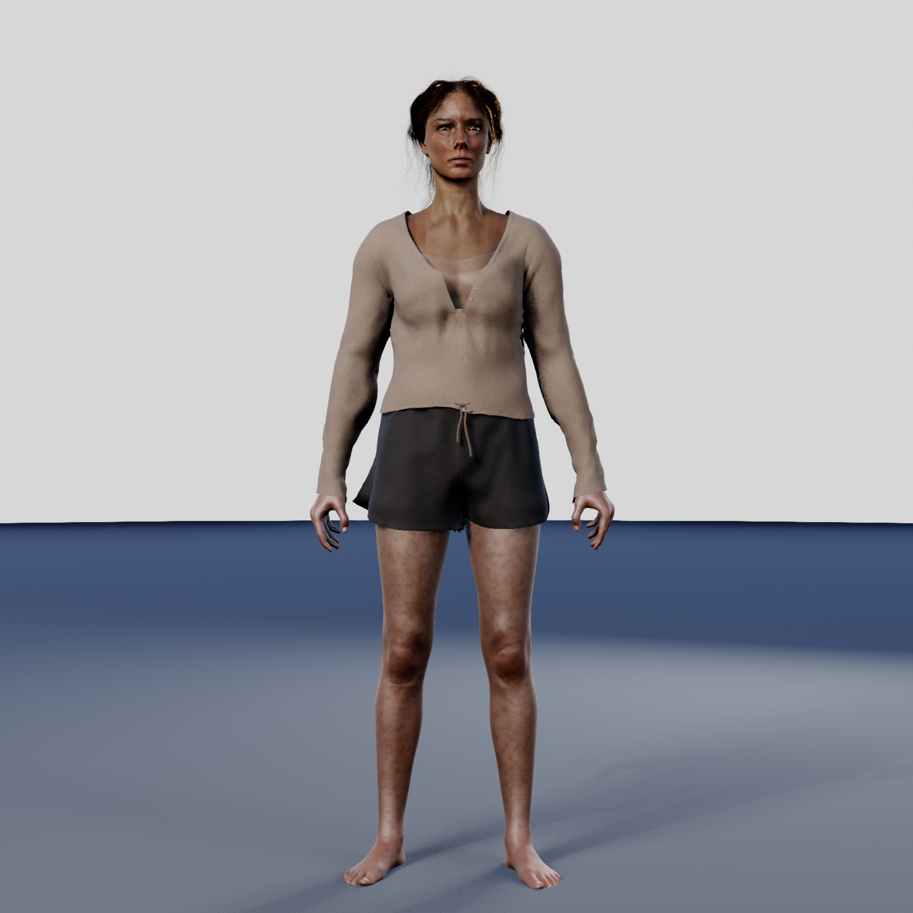
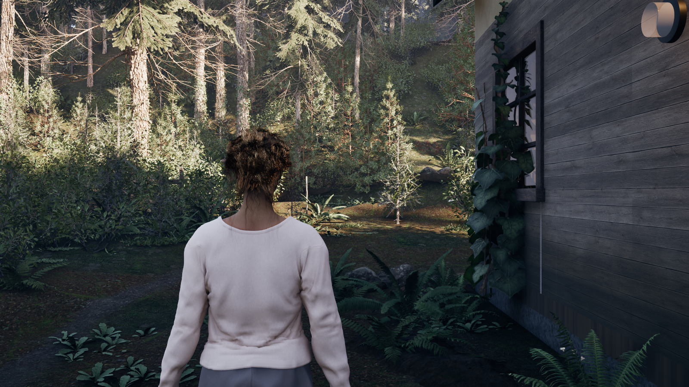
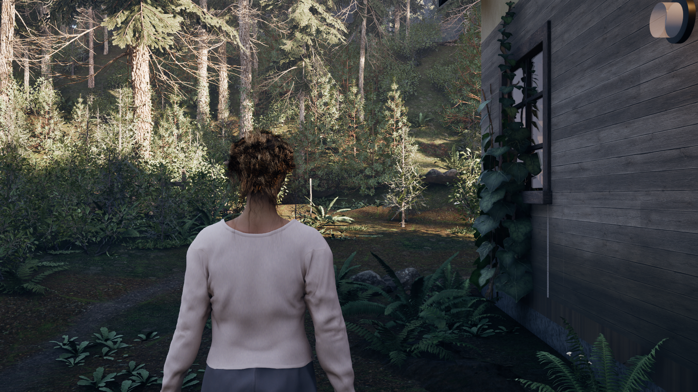

# C48 — Karakter kıyafeti: kalıp, deformasyon ve kumaş incelemesi

**Rapor tarihi: 3 Kasım 2026 · PARTIAL / REVIEW_REQUIRED · ARTIST-GRADE: NO**

Bel–kalça birleşimi ve kumaş yüzeyi iyileştirildi. Göğüs ortası, yaka/pat işçiliği ve dinamik döküm tamamlanmadı. Düzeltmeler ayrı C48 adayına kaydedildi; **ana karakterin üretim referansları değiştirilmedi**.

Anatomi, body/SHCB, skeleton, yüz, saç ve mevcut üretim kıyafetlerini kapsayan 51 dosyanın hash kontrolü başlangıçla aynı. Aday yeni editör oturumunda yeniden açıldı; geçici inceleme sahnesi kaldırıldı.

## Önce / sonra

Aynı kamera, poz ve ışıkta 10 karşılaştırma çifti. 1600 × 1600; tam vücut FOV 31°, yakın plan FOV 21°; sabit manuel pozlama −1,2 ve 6500 K; bloom ve hareket bulanıklığı kapalı. Gerçek oyuncu pawn’ının beden retarget ve postprocess zinciri kullanıldı. Görüntüler rötuşlanmadı.

### Bel / kalça üstü

| Önce — üretimdeki kıyafet | Sonra — A4 aday |
|---|---|
|  |  |

### Göğüs

| Önce — üretimdeki kıyafet | Sonra — A4 aday |
|---|---|
|  |  |

### Tam vücut

| Önce — üretimdeki kıyafet | Sonra — A4 aday |
|---|---|
|  |  |

[Göğüs paftası](boards/chest_compare.jpg) · [Bel paftası](boards/waist_compare.jpg) · [Tam vücut paftası](boards/full_compare.jpg)

### Tüm eşleşen açılar

| Görünüm | Önce | Sonra |
|---|---|---|
| Göğüs / ön | [Aç](captures/plate_before_chest_front_runtime.png) | [Aç](captures/plate_after_chest_front_runtime.png) |
| Göğüs / üç çeyrek | [Aç](captures/plate_before_chest_3q_runtime.png) | [Aç](captures/plate_after_chest_3q_runtime.png) |
| Göğüs / yan | [Aç](captures/plate_before_chest_side_runtime.png) | [Aç](captures/plate_after_chest_side_runtime.png) |
| Bel / arka | [Aç](captures/plate_before_waist_back_runtime.png) | [Aç](captures/plate_after_waist_back_runtime.png) |
| Bel / arka üç çeyrek | [Aç](captures/plate_before_waist_rear3q_runtime.png) | [Aç](captures/plate_after_waist_rear3q_runtime.png) |
| Bel / yan | [Aç](captures/plate_before_waist_side_runtime.png) | [Aç](captures/plate_after_waist_side_runtime.png) |
| Tam vücut / ön | [Aç](captures/plate_before_full_front_runtime.png) | [Aç](captures/plate_after_full_front_runtime.png) |
| Tam vücut / yan | [Aç](captures/plate_before_full_side_runtime.png) | [Aç](captures/plate_after_full_side_runtime.png) |
| Tam vücut / arka | [Aç](captures/plate_before_full_back_runtime.png) | [Aç](captures/plate_after_full_back_runtime.png) |
| Tam vücut / üç çeyrek | [Aç](captures/plate_before_full_3q_runtime.png) | [Aç](captures/plate_after_full_3q_runtime.png) |

## Hareket kaydı

**[18 saniyelik yan yana önce / sonra videosu](video/C48_before_after_motion.mp4?raw=true)**

[Önce kaydı](video/review_motion_before.mp4?raw=true) · [Sonra kaydı](video/review_motion_after.mp4?raw=true) · [İncelenen hareket kareleri](boards/motion_after_samples.jpg) · [Çömelme dahil seçilmiş pozlar](boards/final_deform_after_contact.jpg)

Duruş, yürüyüş, koşu, dönüş, eğilme ve kol hareketi mevcut kliplerle gerçek pawn üzerinde kontrollü oynatıldı. Kayıt, klavye/gamepad ile serbest oynanış veya çalışan kumaş simülasyonu kanıtı değildir. Bağımsız kayıtlarda küçük faz farkları vardır.

## Gerçek oyun kamerası

L_GR_SphirusHouse, mevcut ışık ve kamera, aynı sabit poz; FOV 60°. Kamera konumu ve açısı iki çekimde aynı. Arka beldeki raf görünümünün azalması oyun mesafesinde de okunuyor.

| Önce | Sonra — yalnızca inceleme PIE oturumunda aday takılı |
|---|---|
|  |  |

## Kaynak, uygulanan düzeltme ve kalan iş

| Bölge | Görsel bulgu | Neden | Uygulanan düzeltme | Son durum |
|---|---|---|---|---|
| Göğüs / kalıp | Göğüs altına fazla yapışan, her hacmi ayrı izleyen geçiş; koşu fazında bedenin kumaştan çıkması. | Sorun malzemeden önce geometride ve deformasyon payında. Simülasyon kapalı karşılaştırma da form sorununu koruyor. | Göğüs–kaburga geçişi yumuşatıldı; ön panele en fazla 1,45 cm ek hareket payı verildi. Örnek koşu pozundaki belirgin taşma kapandı. | PARTIAL: göğüs ortasındaki gerilim ve ayrı kalıp hissi sürüyor. |
| Bel / kalça üstü | Arka belde keskin çöküntüler, üst üste katlanmış sert bir etek bandı ve raf görünümü. | Eski idle pozunda yerleşmiş kalıp ve 7 mm dışa açılan etek ofseti. Görünüm, aktif kumaş hareketinin ürünü değil. | Gerçek oyuncu pozunda arka bel geçişi yeniden düzenlendi; küçük keskin katlar yumuşatıldı, etek bandının çıkıntısı azaltıldı. Anatomi değiştirilmedi. | PARTIAL: belirgin iyileşme; yakın planda etek ve yan dikiş işçiliği yeniden ele alınmalı. |
| Deformasyon | Koşu, kol hareketi ve koltuk altında aşırı sıkışan kıvrımlar. | Kıyafet kemik ağırlıkları ve geometrisi mevcut beden hareketini tam karşılamıyor. Eski düzeltici şekiller yeni kalıba yeniden uyarlanmış değil. | Mevcut ağırlıklar ve skeleton korundu; geometriye hareket payı eklendi. Yürüyüş, koşu, duruş, dönüş, eğilme, kol hareketi ve çömelme örnekleri incelendi. | PARTIAL: tam hareket aralığı ve düzeltici deformasyonlar tamamlanmadı. |
| Kumaş / materyal | Fazla iri, sert örgü ayrıntısı; gövdeye paralel tekrarlayan yapay izler. | Detay normalinin yüksek şiddeti, kaba normal ve mevcut UV/yüzey örüntüsü. | 180 g/m² sınıfı pamuk–modal jersey hedeflendi. Ana detay normal şiddeti 0,85 → 0,28; yaklaşık ilmek aralığı 0,9 → 0,66 mm. Kaba normal 0,35 katsayısına indirildi, yansıma yumuşatıldı. Şorta da ayrı materyal adayları üretildi. | PARTIAL: yeni özgün tekstil bake’i, yaka/pat kalınlığı ve dikiş işçiliği eksik. |
| Chaos / teknik | Simülasyon açık görünmesine rağmen aç/kapa kıyaslarında bağımsız döküm oluşmuyor. | Mevcut StaticMeshImport bölüm yolunda Geometry Script ağırlık haritası taşınmıyor. MaxDistance alt değeri sıfır ve harita kayıp; kıyafet fiilen kemik deformasyonu izliyor. | Kaynak kodu ve runtime özellikleri denetlendi. Ayrı adaylarda fizik ayarı denendi; etkisiz sonuç kabul edilmedi. | FAIL: ağırlık haritası aktarımı ve gerçek kumaş simülasyonu onarılmadı. Python/Dataflow okuma denemesi editörü çökertti; üretim asset’i değiştirilmedi. |

## Tasarım ve kumaş hedefi

Onaylı Guardian konsepti: bedene yakın fakat rahat, yulaf/grej Henley; açık yaka ve düğme şeridi; yüksek kalça seviyesinde yumuşak etek; koyu rahat şort. Ana hedef yumuşak pamuk–modal jersey: omuzdan taşınan yüzey, göğüs altında yumuşak geçiş, belde nedenli kıvrımlar ve temiz alanlar.

[Projede bulunan onaylı konsept](captures/approved_concept.png)

Kumaş ve kesim referansları: [180 g/m² pamuk–modal jersey](https://dongyuetextile.com/180gsm-cotton-modal-jersey/), [jersey Henley](https://www.marksandspencer.com/marled-jersey-henley-top/p/clp60745597), [ince rib Henley](https://www.quince.com/women/women-organic-cotton-micro-rib-henley-long-sleeve-tee), [yulaf renkli Henley](https://www.bamboobody.com.au/products/long-sleeve-henley-top-oatmeal). 180 g/m² sanat yönü hedefidir; etkin simülasyonda ölçülmüş kumaş ağırlığı değildir.

## Görsel kabul

| Kontrol | Karar |
|---|---|
| HENLEY/TOP SILHOUETTE | PARTIAL |
| TOP CONSTRUCTION | FAIL |
| TOP MATERIAL | PARTIAL |
| BOTTOM SILHOUETTE | PARTIAL |
| BOTTOM CONSTRUCTION | PARTIAL |
| BOTTOM MATERIAL | PARTIAL |
| GARMENT DRAPE | PARTIAL |
| CHARACTER MATERIAL COHERENCE | PARTIAL |
| CONCEPT ART-DIRECTION MATCH | PARTIAL |
| HERO CHARACTER QUALITY | FAIL |
| ARTIST-GRADE | NO |

## Teknik doğrulama

| Kontrol | Karar |
|---|---|
| Protected body/SHCB/skeleton/face/groom and production assets | PASS: 51 file hashes unchanged |
| Matched still camera and body pose | PASS: 10 pairs, numeric camera/FOV/pose equality |
| Garment source topology | PASS: unchanged 8075 vertices / 14877 triangles; existing welded Chaos path reused |
| Staged motion review | PARTIAL: six sequences plus selected crouch/deformation poses |
| Real gameplay camera | PASS for matched static comparison only |
| Dynamic garment behavior | FAIL: MaxDistance import unresolved |
| High-elevation shoulder and full-range extreme poses | NOT_TESTED |
| Garment LOD 0/1/2 and sync | NOT_TESTED |
| Measured GPU/RHI/streaming/performance | NOT_TESTED |
| Keyboard/gamepad free gameplay | NOT_TESTED |
| Saved final candidate | PASS |
| Reopen after final save | PASS: clean editor session; candidate, graph, mesh, collider and final materials loaded; no temporary stage actors |

## Aday ve devam edilecek çalışma

- Unreal adayı: `/Game/Sphirus/CharacterLab/CostumeFit_20261103/Cloth/CA_C48_Henley_a4`. Son Henley materyalleri bu asset’e kaydedildi. Üretim Blueprint’i bu adaya yönlendirilmedi.
- Materyaller: aynı kökte `Materials/MI_C48_Henley_0..2`, `MI_C48_Shorts_0..2`, `M_C48_Textile_B`. Şort geometrisi değiştirilmedi.
- Blender çalışma dosyası proje içinde `SourceAssets/Characters/CostumeFit_20261103/C48_GarmentFit_Review.blend` konumunda. Bu GitHub paketi raporu ve görsel kanıtları içerir; Unreal/Blender üretim dosyalarını içermez.
- Geri dönüş kopyaları proje içinde `Saved/Codex/SHME_V233_20261027/checkpoint/manifests/costume48_*` altında.

**En değerli sonraki düzeltme:** göğüs önü–pat–yaka bağlantısını sürekli dikilmiş panel olarak yeniden işlemek; ardından kıyafete ait düzeltici deformasyonları yeni kalıba uyarlamak ve Chaos MaxDistance aktarımını onarmak. Dinamik döküm, LOD ve performans doğrulanmadan aday bitmiş sayılmamalı.

## Rapor verileri

[HTML raporu (indirilebilir)](review.html?raw=true) · [Yapılandırılmış rapor](review.json) · [Kamera / poz eşleşmeleri](capture_manifest.json) · [51 dosyanın koruma kontrolü](preservation_result.json) · [Yeniden açma doğrulaması](reopen_verification.json) · [Son aday](final_candidate.json) · [Dosya manifesti](manifest.json)

Bu yayın yalnızca kıyafet raporunu ekler; dünya export’unun `chatgpt-bridge/latest/LATEST.json` işaretçisini değiştirmez.
