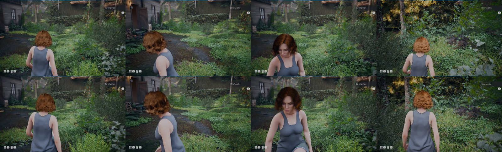
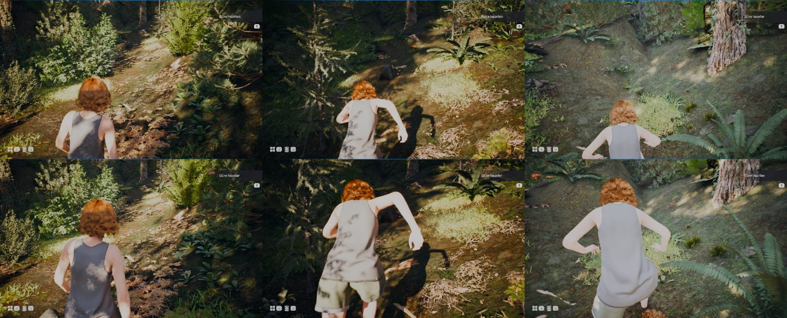
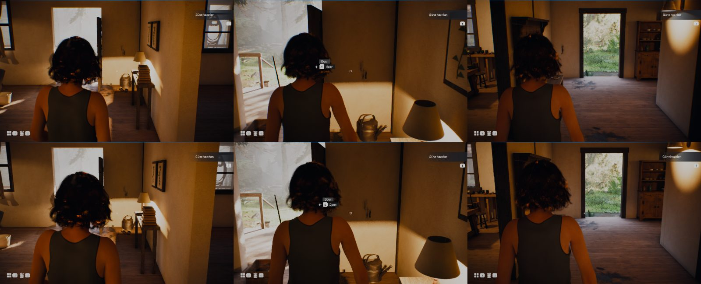
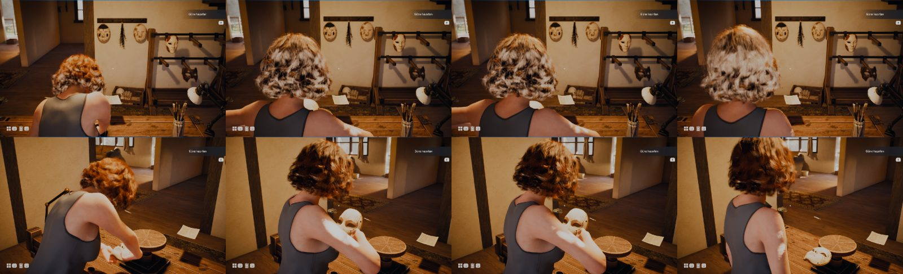
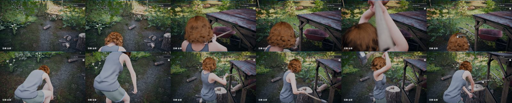
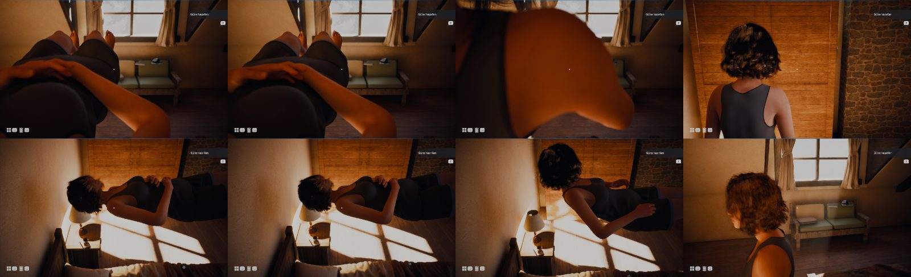
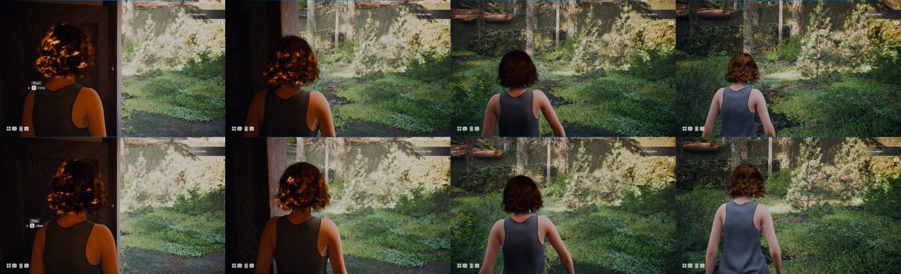
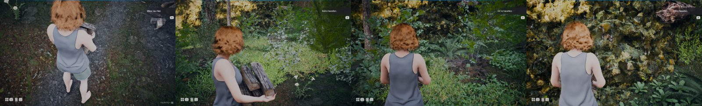
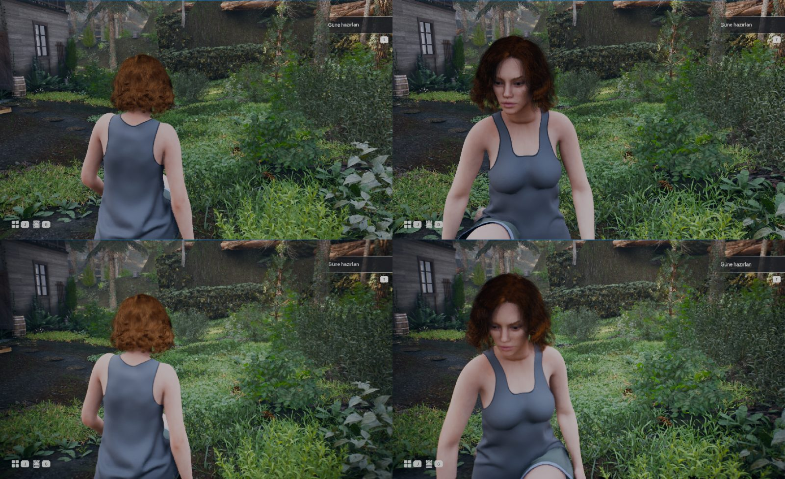
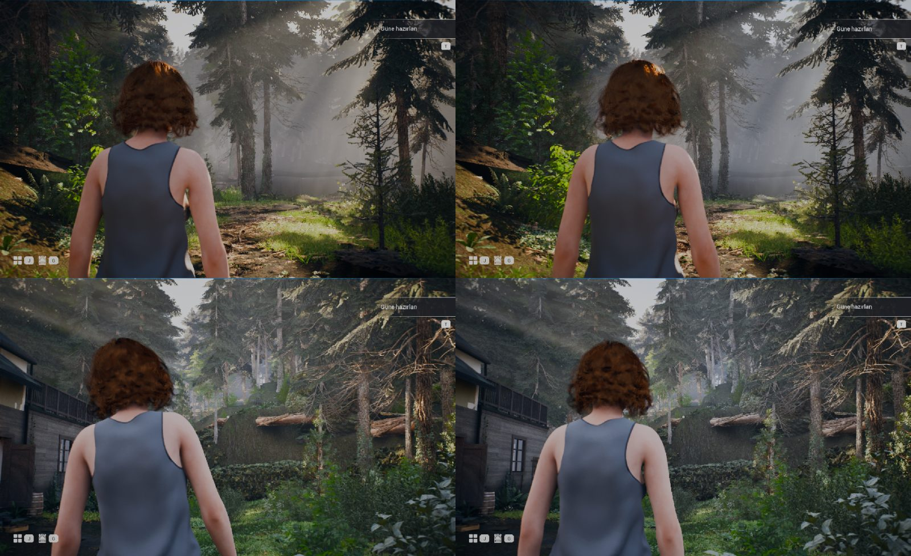

# Sphirus: bedensel yakın kamera, etkileşim kadrajı, lens ve rezonans (2026-11-12)

Bu rapor kamera görevinin gerçek projedeki uygulamasını, önce/sonra ölçümlerini ve gerçek oyundan alınmış kesintisiz videoları içerir. Teknik sonuç, benim görsel incelemem ve kullanıcı kabulü ayrı sütunlardır. **Kullanıcı kabulü yok**: sonucu oyunda sen değerlendireceksin.

Görevde anılan üç ekran fotoğrafı bu oturuma ulaşmadı (yüklenen tek dosya görev metniydi). Hata referansı olarak mevcut kameranın (A) doğrudan oyun kayıtlarını kullandım; fotoğrafları gördüğümü iddia etmiyorum.

## 0. Başlangıç durumu ve korunanlar

- Motor 5.8.4, harita `L_GR_SphirusHouse`, oyuncu `BP_HybridA_Player` (GameMode `BP_GM_GR_GraceRanger`).
- Hareket tabanı: 11 Kasım'da geri yüklenen GASP Relaxed + sprint kilidi. `ABP_Sph_GASP.SphCM = False`, hızlar 165 / 375 / 585. Reddedilen Core Motion profili etkinleştirilmedi; yeni hareket katmanı kurulmadı.
- Senin güncel kaydın: `SFSaveSlot.sav`, 11 Kasım 19:47, 6193 bayt, SHA1 `66556281…` (editör günlüğüne göre 19:33–19:47 arasındaki kendi oyun oturumun yazdı). Her test kaydı kenara alıp sonunda bayt bayt geri koydu; iş sonunda SHA1 aynı.
- Geri dönüş noktası: `C:\Users\berat\SphirusCheckpoints\Camera_Pre_20261112_0215` (sha1 listeli).
- Haritalara, ışığa, pozlama hacimlerine, karaktere ve Story Framework çekirdeğine dokunulmadı.

## 1. Sonuç özeti

| Konu | Önce (A) | Sonra (C) | Teknik | Görsel incelemem | Kullanıcı kabulü |
|---|---|---|---|---|---|
| Tek kamera sahibi | oyuncu Tick zinciri + istasyonların bakış kilidi | `SphCamera` bileşeni; istasyonlar bağlam bildiriyor | IMPLEMENTED, TECH_TESTED | — | yok |
| Dış mekân kadrajı (bahçe, yürüme) | baş merkezi 0,34; 0,49 (ekranın ortası), omuz–kamera 165 cm | 0,35; 0,35 (üst üçte bir), 144 cm | TECH_TESTED: PASS | VISUALLY_INSPECTED: karakter solda, baş–omuz–sırt görünür, önündeki yol okunuyor | yok |
| Sprintte mesafe (yokuş patika) | ortanca 214, en çok 230 cm | ortanca 161, en çok 181 cm | PARTIAL: hedef bandın (110–150) biraz üstünde | VISUALLY_INSPECTED: kopukluk yok | yok |
| Ev içi kadraj (koridor) | 0,33; 0,36, 112 cm | 0,36; 0,33, 92–110 cm; duvara göre yaklaşma ve yumuşak açılma | TECH_TESTED: PASS | VISUALLY_INSPECTED: dar yerde baş kadrajın ortasına yaklaşıyor | yok |
| Maske tezgâhı (al, incele, bırak) | sağ el görünür %0; baş ve saç işin önünde | sağ el görünür %92, tezgâh (hedef) %100; baş 0,41; 0,20; odak 123 cm, f/5,6 | TECH_TESTED: PASS | VISUALLY_INSPECTED: maske ve eller görünüyor; maske sağ omza yakın | yok |
| Yerden odun alma | hedef görünür %4, sağ el %15; karakter kadrajın altına iniyor | sağ el görünür %100, odun %78 | TECH_TESTED: PASS | VISUALLY_INSPECTED: ayakta beklerken baş kadraj dışında, eğilince omuz, el ve odun birlikte | yok |
| Odun kesme | kütük görünür %0–5, kamera kolun içine giriyor | kütük %100, sağ el %98–100; savuruştan sonra %94 | TECH_TESTED: PASS | VISUALLY_INSPECTED: omuz, iki el, sap, kütük ve baş üstü savuruş kadrajda | yok |
| Yatak | kamera bedenin içinde (omuz–kamera 31 cm, baş kadraj dışı) | yandan üst açı, baş 0,41; 0,34, 113 cm | TECH_TESTED: PASS | VISUALLY_INSPECTED: beden okunuyor; kalkışta karakter kameraya dönük | yok |
| Kapıdan geçiş | 0,33; 0,43, dışarıda 157 cm'ye açılıyor | 0,36; 0,35, 119–139 cm; çarpışma düzeltmesi 0 kare | TECH_TESTED: PASS | elin kulba uzandığı bir animasyon yok (kapı E ile açılıyor) | yok |
| Çay, şömine | — | profil tanımlı | NOT_TESTED (istasyonlar test başlangıcında tetiklenmedi) | — | yok |
| Bakışın süzülmemesi | fareyle dönüşte 16,1–18,7° gecikme | tek karelik ölçüm farkı (5–6°) | TECH_TESTED: PASS | — | yok |
| İki elli yük kuralı | sprint ve zıplama serbestti | sprint yok, zıplama yok, tempo 322 cm/sn | TECH_TESTED: PASS; geri bildirim YOK | VISUALLY_INSPECTED | yok |
| Lens | renk sapması 0,60, çift vinyet, çift gren | 0,10 / 0,28 / 0,03; odak temas noktası–el arası | IMPLEMENTED, TECH_TESTED | VISUALLY_INSPECTED: B ile C arasında fark hafif vinyet ve kenar yumuşatma | yok |
| Rezonans örneği | yok (hacim vardı, sürülmüyordu) | zarf + derinlikle sınırlı kırılma + uzak alan renk işareti; `BP_GR_FirstBreak` bağlı | IMPLEMENTED, TECH_TESTED: zarf ve bekleme süresi PASS; baş koruması PASS (tepe anında saç doygunluğu 0,40, etkisizken 0,41; korumadan önce 0,30'a düşüyordu); olayın oyun akışında tetiklenişi NOT_TESTED | VISUALLY_INSPECTED: uzak orman soluyor ve serinliyor, yakın zemin ve gövde sabit | yok |
| Konfor ayarları | yok | bileşen değişkenleri (hareket azaltma, FOV tercihi, ölçekler) | IMPLEMENTED; menü YOK; oyun içinde sınanmadı | — | yok |
| Atmosfer / masalsı kimlik | — | yapılmadı | — | — | — |
| Performans | 31,2 kare/sn (oyun iş parçacığı 16,5 ms) | 30,9 kare/sn (16,4 ms); kameranın ölçülebilir maliyeti yok | PERFORMANCE_TESTED (PIE, tek rota); 60 kare/sn bu donanımda sağlanmıyor (GPU sınırı, kameradan bağımsız) | — | yok |
| Temiz açılış | — | PASS: editör kapatılıp açıldıktan sonra dokuz Blueprint güncel ve hatasız; `SphCamera.Enabled` varsayılanı True; hiçbir ayar zorlanmadan alınan bahçe kaydında baş merkezi 0,35; 0,33, omuz–kamera 135 cm (`K_yard_P1`); hareket profili değişmedi; kirli paket yok; kayıt dosyası SHA1 aynı | | | |

Durum etiketleri: IMPLEMENTED = projede kayıtlı; TECH_TESTED = gerçek oyunda ölçüldü; VISUALLY_INSPECTED = kayıtlardan saniyede bir alınan kare dizilerini inceledim; PERFORMANCE_TESTED = kare maliyeti ölçüldü; USER_ACCEPTED = yok.

Görsel incelemenin sınırı: videoları gerçek hızda izleyemiyorum. Akıcılık için dayanağım kare başına telemetri (kameranın kapsüle göre ikinci farkı, sıçrama ve çarpışma kareleri) ve saniyede bir kare; iki kare arasındaki kısa bir titremeyi ya da pompalamayı gözle doğrulamadım. Videolar bunun için ekte.

## 2. Kamera, lens ve post-process sahipliği (canlı projeden, 2026-11-12)

Okuma: `Tools/Camera_20261112/q_own.py`, `q_own2.py` (salt okuma; dökümler `Saved/Codex/Camera_20261112/own/`).

### Önce (A)

| Özellik | Yazan | Not |
|---|---|---|
| Yay kolu uzunluğu, omuz/yükseklik ofseti, hedef ofseti | `BP_HybridA_Player` olay grafiği, Tick zinciri (`GR_ArmBase`, `GR_CamKick`, `GR_CamShoulder`, `GR_CamZ`, `GR_LagPivot`, `GR_LatOff`) | pivot = kapsül + 66 cm (baş kemiği hizası); kamera başın üstünden aşağı bakıyor |
| FOV | aynı zincir (`GR_CamFov`: ev 62, dış 66, hızda +3) → `Camera` ve `Cine` | |
| Odak ve diyafram | aynı zincir: bakış ekseni ışını ya da (eylemde) sağ el; f/9, eylemde f/4 | |
| Bakış yönü | oyuncu (`IA_Sph_Look`); **eylemde** aynı zincir `SetControlRotation` ile karakterin arkasına, −18° | "aksiyon kamerası": kol 70, omuz 17 |
| Eylem tetikleyicisi | istasyonlar `SetIgnoreLookInput(true)` çağırıyor; zincir bunu "eylem var" diye okuyor | hedefin ne olduğu bilinmiyor |
| Sabit kameraya geçiş | `BP_GR_DayStation` / `BP_GR_DayHub` (`GR_CamFov > 0` ise `SetViewTargetWithBlend`), `BP_GR_AtticContext` (tavan arası) | gün istasyonlarında `GR_CamFov` 0: kullanılmıyor |
| Post-process | `EX_PostRain_NeutralExposure` (sınırsız; renk, otomatik pozlama, yerel pozlama, vinyet 0,40, gren 0,08), `EX_Look_PPV_House/Shelf/Glade` (bölgesel pozlama), `EX_Look_Resonance` (ağırlık 0, kimse sürmüyor), `BP_TrueLens` bileşeni (öncelik 1000), `Cine` kamera bloğu (renk sapması 0,60, vinyet 0,38, gren 0,08, `M_Sph_EdgeSoft`) | |
| Kamera yöneticisi sınıfı | `BP_Sph_CameraManager` (boş grafik; pitch −62…+42) | |
| GASP kamerası | `GameplayCamera` bileşeni ve `Camera(NotUsedByDefault)` etkin değil | |

### Sonra (B/C)

Tek sahip: `/Game/Sphirus/Player/Camera/AC_Sph_Camera` (oyuncudaki adı `SphCamera`).

Akış (bileşen Tick'i; kapsül hareket ettikten sonra, yay kolu değerlendirilmeden önce):

1. İşaretler: hız, ivme, bakış yönü, bakış kilidi.
2. Açıklık sondaları (5 ışın, kamera kanalı).
3. Süzülmüş çapalar: baş merkezi yüksekliği (3,5/s), göğüs (8/s), derinlik gecikme pivotu, yanal baş takibi.
4. Bağlam: istasyonun bildirdiği hedef/tür/temas; evre (hazırlık, uzanma, temas, işleme, toparlanma).
5. Serbest kadraj: mesafe (açıklık + hız), baş merkezinin ekrandaki hedefi (normalize).
6. İş kadrajı: hedefe göre dünya uzayında kamera konumu ve bakış; yay kolu çerçevesine çevrilir.
7. Karışım → yay kolu (çarpışma motorun kendi süpürmesinde kalır).
8. Lens: FOV, odak (bağlam hedefi → bakış ekseni → son geçerli değer), diyafram.
9. Algı katmanı: rezonans zarfı → `MPC_Sph_Perception`.
10. Yardımlı bakış: yalnız bakış kilitliyken, iş kadrajına doğru.

İstasyonlar kamera taşımıyor; bağlam bildiriyor: `CtxBegin(hedef aktör, tür, temas noktası, temas süresi)`, `CtxHit()`, `CtxEnd()`.

Eski zincir yerinde duruyor ama yalnız `SphCamera.Enabled = False` iken çalışıyor (A referansı ve geri dönüş anahtarı). Aynı anda tek yazıcı var.

## 3. Kamera yöneticisi: nasıl çalışıyor

### 3.1 Serbest dolaşım kadrajı

Kadraj santimetreyle değil, ekrandaki hedefle tanımlı. Baş merkezi (baş kemiği + 9 cm) ekranın `HeadX = 0,34`, `HeadY = 0,33` noktasına gelecek şekilde yay kolunun yan ve dikey ofseti her karede FOV'dan ve görüntü oranından hesaplanıyor (16:9, 16:10, 21:9'da aynı normalize hedef). Mesafe ayrı bir değişken:

| Bağlam | Hedef mesafe (pivot–kamera) | Dar alanda | Hızda ek | Derinlik gecikmesi |
|---|---|---|---|---|
| Dış mekân | 124 cm | 108 cm | +4 cm (200 cm/sn'den 450 cm/sn'ye) | en çok 15 cm, 10/sn |
| Ev | 98 cm | 86 cm | aynı | aynı |

Pivot: yatayda kapsül (düşük frekanslı) + başın yanal sapmasının süzülmüş izlemesi (4/sn, ±30 cm); dikeyde baş merkezinin kapsüle göre yüksekliği (2,5/sn süzgeç) ve kapsül yüksekliğinin ayrı süzgeci (5/sn, ±20 cm). Karakter eğildiğinde ya da çömeldiğinde kamera da iniyor; adım salınımının büyük kısmı süzülüyor.

Bakış süzülmüyor: yay kolunun dönüş gecikmesi kapalı. Fiziksel tepki: ileri ivmenin sızıntılı integrali (±8 cm; hızlanmada açılma, frende yaklaşma), dinamik FOV (dış 66°, ev 62°, koşuda +3°). Sinüs ya da rastgele sarsıntı yok.

Engel: yöneticinin kendi küre süpürmesi istenen kamera yolunu her karede yokluyor; engelde hemen çekiliyor, engel kalkınca 1,6/sn ile yumuşak açılıyor. Motorun yay kolu süpürmesi son güvenlik olarak açık.

### 3.2 İş kadrajı ve evreler

İstasyon yalnız şunu bildiriyor: hedef aktör, tür, temas noktası, temas süresi (`CtxBegin`), gerçek temas anı (`CtxHit`), bitiş (`CtxEnd`). Kamera konumu dünya uzayında çözülüyor:

kamera = süzülmüş göğüs − iş ekseni × geri + sağ × yan + yukarı × yükseklik; bakış = baş ile temas noktası arasında ağırlıklı nokta.

İş ekseni karakterden temas noktasına. Sonuç yay kolu parametrelerine çevrildiği için çarpışma aynı yoldan geçiyor. Bakış yönünü yalnız istasyon bakışı kilitlemişken kamera çeviriyor (3/sn); kilit kalkınca yaw olduğu yerde kalıyor, eğim eylem öncesi değere 3/sn ile dönüyor ve fare hareketinde yardım hemen bırakıyor.

| Tür | Geri | Yan | Yükseklik (göğüsten) | Hedef ağırlığı | FOV | Diyafram |
|---|---|---|---|---|---|---|
| Yerden odun / ot / parça alma (1, 2, 22) | 105 | 62 | 45 | 0,40 | 64 | f/5,6 |
| Odun kesme (3) | 112 | 70 | 46 | 0,30 | 66 | f/5,6 |
| Şömine (4) | 95 | 62 | 42 | 0,40 | 62 | f/5,6 |
| Çay (5) | 55 | 66 | 34 | 0,36 | 62 | f/5,6 |
| Dolap / kıyafet (6, 7) | 85 | 52 | 22 | 0,36 | 62 | f/5,6 |
| Yatak (9) | 10 | 125 (yandan) | 70 | 0,20 | 64 | f/8 |
| Maske tezgâhı (20) | 52 | 68 | 36 | 0,34 | 62 | f/5,6 |

Evreler gerçek durumdan türetiliyor, sabit saniyelerden değil:

| Evre | Koşul | Kamera |
|---|---|---|
| Hazırlık | bağlam açık, karakter yerine yürüyor | iş kadrajına geçiş (3,2/sn) |
| Uzanma | bağlam açık, temas bildirilmedi | hedef ve el yolu kadrajda |
| Temas | istasyonun temas bildirimi, 0,6 sn | en kararlı an; kesmede tek kısa yaklaşma (5 cm, ~0,3 sn'de sönüyor) |
| İşleme | temastan sonra, kilit sürerken | %10 daha yakın |
| Toparlanma | kilit kalktı | serbest kadraja dönüş (2,2/sn), eğim yardımı |
| İptal | bakış kilidi 0,8 sn'den uzun süre yokken bağlam açık kalmışsa | bağlam kendiliğinden kapanır |

Görüş tarafı: bağlam başında bir kez karar veriliyor; sağ taraf duvarla kapalı ve sol açıksa sol omuz, aksi hâlde sağ. Eylem sırasında taraf değişmiyor.

### 3.3 Lens ve odak

Tek yazıcı yönetici. Odak önceliği: iş bağlamında temas noktası ile çalışan elin ortası → bakış ekseni üzerindeki yüzey (220–2000 cm) → ışın boşa giderse son geçerli değer. Geçiş 3/sn + Cine kameranın kendi yumuşatması. Diyafram dolaşımda f/8, işte f/5,6 (yaklaşık 19 mm odak uzaklığında el, nesne ve temas birlikte net kalıyor), `DofScale` ile f/22'ye kadar kapatılabiliyor.

### 3.4 Algı katmanı: rezonans

`MPC_Sph_Perception.Resonance` değerini yalnız yönetici yazıyor: giriş 1,6/sn, tutma, çıkış 0,9/sn, olay başına bekleme (tutma + 6 sn) içinde yeni tetikleme yok sayılıyor. `M_Sph_Resonance` yalnız uzak havayı kırıyor: ofset sahne derinliğiyle ağırlıklı (9 m altında sıfır, 26 m ötesinde tam) ve hem kaynak hem kaydırılmış pikselin derinliğine bakıyor; karakter, eller, yakın zemin ve kullanılabilir nesneler sabit kalıyor. Destek işareti aynı malzemede: uzak alanda hafif doygunluk düşüşü ve serin kayma. Örnek olay: mevcut `BP_GR_FirstBreak` (askı yanındaki ilk kırılma) başlarken 2,5 sn'lik bir darbe istiyor, biterken durduruyor; olayın tetik mesafesi, günlük kaydı ve kayıt davranışı değişmedi.

### 3.5 Konfor ayarları

Bileşen üzerinde, örnek başına değiştirilebilir: `ReduceMotion` (ivme tepkisi, dinamik FOV ve lens kırılması %35'e iner; rezonansın sabit renk işareti kalır), `KickScale`, `DynFovScale`, `DofScale`, `ResScale`, `UserFov` (oyuncu FOV tercihi, profil geçişlerinde korunur), `Side` (omuz tarafı). Hareket bulanıklığı zaten kapalı. Bu ayarlar için oyun içi menü yok; gren ve vinyet için ayrı anahtar yok.

## 4. Önce / sonra ölçümleri

Yöntem: aynı harita, aynı başlangıç noktası, aynı girdi planı; oyuncu kamerasından, 30 kare/sn oyun adımıyla kesintisiz kayıt (`vcam3.sh` / `vcam4.sh`). Her karede kamera, beden kemikleri, yay kolu, bağlam evresi, baş/omuz/el/hedef ekran konumu ve bedenin eli ya da hedefi kapatıp kapatmadığı yazılıyor (`an_cam.py`).

- Baş merkezi: baş kemiği + 9 cm, normalize ekran konumu (x; y), bölüm ortancası.
- "Görünür": nokta ekranın %8 kenar payı içinde ve kamera ışını baş, boyun, göğüs, omuz ya da karşı kol küreleriyle kesilmiyor. Bu bir küre modeli; saç ve kıyafet dahil değil.
- Titreme: kameranın kapsüle göre konumunun ikinci farkının p95'i (cm/kare²). Fareyle dönüş bölümlerinde yörünge hareketinin kendisini ölçer, karşılaştırma için kullanılmamalı.
- A kayıtlarında lens bloğu: `K_*_A` etiketliler eski lens değerleriyle (renk sapması 0,60), `K_*_A2` etiketliler yeni lens değerleriyle alındı; kamera davranışı ikisinde de eski zincir.

Test aracıyla ilgili bir düzeltme: ilk kayıtlarda araç, istasyon bakışı kilitlemişken de bakış yönünü her karede yazıyordu. Gerçek oyuncu bunu yapamaz; bu yüzden ilk odun/kesme kayıtları (A ve B) gerçek oyunu göstermiyordu. Araç düzeltildi ve bu senaryolar yeniden kaydedildi; aşağıdaki tablolar düzeltilmiş kayıtlardan.

### Bahçe (fare sabit: ileri, sola, sağa, geri, yürürken dönüş)

| Bölüm | Baş merkezi x; y (A → C) | Omuz–kamera cm, ortanca / en çok (A → C) | Sağ el görünür (A → C) | Sol el görünür (A → C) | Hedef görünür (A → C) | Kamera titremesi p95 (A → C) |
|---|---|---|---|---|---|---|
| duruş | 0.32; 0.49 → 0.35; 0.32 | 148 / 171 → 128 / 148 | 0% → 14% | 0% → 11% | - → - | 0.8 → 2.23 |
| ileri yürüme | 0.34; 0.49 → 0.35; 0.35 | 165 / 176 → 144 / 161 | 14% → 25% | 7% → 20% | - → - | 2.24 → 2.0 |
| sola (A) | 0.31; 0.51 → 0.34; 0.35 | 156 / 158 → 139 / 141 | 0% → 0% | 0% → 0% | - → - | 0.39 → 0.42 |
| sağa (D) | 0.34; 0.49 → 0.36; 0.34 | 146 / 162 → 126 / 154 | 0% → 0% | 0% → 0% | - → - | 0.41 → 0.4 |
| geri (S) | 0.29; 0.53 → 0.32; 0.32 | 133 / 138 → 123 / 128 | 0% → 0% | 0% → 27% | - → - | 2.12 → 0.96 |
| yürürken 90° dönüş | 0.35; 0.34 → 0.36; 0.36 | 159 / 171 → 149 / 152 | 44% → 33% | 48% → 33% | - → - | 2.26 → 0.96 |

### Yokuş patika (yürüme, sprint, duruş, geri dönüş)

| Bölüm | Baş merkezi x; y (A → C) | Omuz–kamera cm, ortanca / en çok (A → C) | Sağ el görünür (A → C) | Sol el görünür (A → C) | Hedef görünür (A → C) | Kamera titremesi p95 (A → C) |
|---|---|---|---|---|---|---|
| duruş | 0.32; 0.52 → 0.34; 0.31 | 151 / 171 → 126 / 151 | 0% → 25% | 0% → 22% | - → - | 0.52 → 0.86 |
| yürüme | 0.35; 0.53 → 0.36; 0.32 | 168 / 175 → 142 / 150 | 0% → 33% | 0% → 12% | - → - | 0.62 → 0.61 |
| sprint | 0.38; 0.53 → 0.37; 0.33 | 214 / 230 → 161 / 181 | 46% → 64% | 23% → 48% | - → - | 1.7 → 2.14 |
| sprintten duruş | 0.35; 0.49 → 0.35; 0.23 | 159 / 217 → 138 / 172 | 13% → 65% | 12% → 53% | - → - | 0.81 → 0.97 |
| geri dönüş (S) | 0.29; 0.62 → 0.33; 0.41 | 143 / 154 → 129 / 138 | 0% → 0% | 0% → 0% | - → - | 0.42 → 0.86 |

### Ev koridoru (yürüme, duruş, fareyle 300° dönüş, yürüme)

| Bölüm | Baş merkezi x; y (A → C) | Omuz–kamera cm, ortanca / en çok (A → C) | Sağ el görünür (A → C) | Sol el görünür (A → C) | Hedef görünür (A → C) | Kamera titremesi p95 (A → C) |
|---|---|---|---|---|---|---|
| yürüme | 0.34; 0.37 → 0.36; 0.34 | 115 / 130 → 103 / 110 | 4% → 0% | 5% → 0% | - → - | 1.78 → 2.75 |
| duruş | 0.33; 0.36 → 0.36; 0.30 | 103 / 113 → 100 / 105 | 0% → 0% | 0% → 0% | - → - | 2.51 → 2.8 |
| fare ile dönüş | 0.30; 0.36 → 0.35; 0.32 | 101 / 108 → 100 / 109 | 0% → 0% | 0% → 0% | - → - | 52.88 → 65.79 |
| yürüme | 0.33; 0.35 → 0.37; 0.34 | 112 / 118 → 96 / 107 | 0% → 0% | 0% → 0% | - → - | 1.93 → 1.81 |
| duruş | 0.31; 0.37 → 0.34; 0.28 | 113 / 120 → 102 / 108 | 0% → 0% | 0% → 0% | - → - | 0.46 → 0.41 |

### Maske tezgâhı (al, incele, bırak)

| Bölüm | Baş merkezi x; y (A → C) | Omuz–kamera cm, ortanca / en çok (A → C) | Sağ el görünür (A → C) | Sol el görünür (A → C) | Hedef görünür (A → C) | Kamera titremesi p95 (A → C) |
|---|---|---|---|---|---|---|
| yaklaşma | 0.30; 0.44 → 0.35; 0.32 | 118 / 130 → 103 / 116 | 0% → 0% | 0% → 0% | - → - | 38.3 → 1.85 |
| hedefe bakış | 0.29; 0.37 → 0.35; 0.29 | 109 / 110 → 107 / 108 | 0% → 0% | 0% → 0% | 88% → 91% | 1.6 → 1.54 |
| al ve incele | 0.31; 0.43 → 0.41; 0.20 | 76 / 110 → 80 / 107 | 0% → 90% | 0% → 4% | 0% → 99% | 0.13 → 0.27 |
| bırak | 0.30; 0.37 → 0.35; 0.30 | 102 / 106 → 102 / 104 | 0% → 23% | 0% → 6% | 0% → 100% | 0.14 → 0.22 |
| ayrılma | 0.22; 0.63 → 0.34; 0.52 | 88 / 108 → 99 / 108 | 0% → 0% | 0% → 8% | - → - | 0.4 → 3.98 |

### Yerden odun alma, taşıma, kütükte kesme

| Bölüm | Baş merkezi x; y (A → C) | Omuz–kamera cm, ortanca / en çok (A → C) | Sağ el görünür (A → C) | Sol el görünür (A → C) | Hedef görünür (A → C) | Kamera titremesi p95 (A → C) |
|---|---|---|---|---|---|---|
| yaklaşma | 0.32; 0.48 → 0.35; 0.26 | 154 / 176 → 135 / 152 | 14% → 53% | 0% → 34% | - → - | 1.29 → 1.38 |
| oduna bakış | 0.31; 0.48 → 0.35; 0.29 | 152 / 154 → 143 / 144 | 73% → 100% | 0% → 6% | 76% → 86% | 2.84 → 4.34 |
| yerden alma | 0.32; 0.46 → 0.44; 0.01 | 87 / 152 → 124 / 144 | 15% → 100% | 6% → 48% | 4% → 80% | 1.05 → 1.41 |
| taşıma | 0.32; 0.46 → 0.31; 0.34 | 153 / 166 → 141 / 146 | 33% → 20% | 39% → 37% | 88% → 91% | 1.76 → 2.39 |
| kütüğe bakış | 0.30; 0.51 → 0.30; 0.36 | 153 / 154 → 141 / 146 | 100% → 100% | 0% → 0% | 100% → 100% | 1.25 → 2.83 |
| kesme hazırlığı | 0.31; 0.59 → 0.44; 0.25 | 70 / 153 → 126 / 141 | 24% → 98% | 0% → 36% | 5% → 100% | 1.44 → 0.8 |
| savuruş ve sonrası | 0.09; -0.84 → 0.40; 0.28 | 66 / 107 → 126 / 147 | 76% → 91% | 14% → 38% | 0% → 90% | 0.53 → 1.53 |

### Yatak (uzan, kalk)

| Bölüm | Baş merkezi x; y (A → C) | Omuz–kamera cm, ortanca / en çok (A → C) | Sağ el görünür (A → C) | Sol el görünür (A → C) | Hedef görünür (A → C) | Kamera titremesi p95 (A → C) |
|---|---|---|---|---|---|---|
| yaklaşma | 0.23; 0.55 → 0.37; 0.32 | 89 / 98 → 77 / 106 | 0% → 0% | 0% → 0% | - → - | 1.3 → 2.98 |
| yatağa bakış | 0.30; 0.34 → 0.35; 0.28 | 99 / 101 → 103 / 105 | 0% → 0% | 0% → 0% | 100% → 96% | 1.25 → 2.51 |
| uzanma ve yatış | -2.51; 4.68 → 0.41; 0.34 | 31 / 101 → 113 / 132 | 52% → 55% | 0% → 64% | 4% → 4% | 0.31 → 1.08 |
| kalkış | 0.30; 0.34 → 0.34; 0.41 | 94 / 100 → 110 / 136 | 14% → 19% | 0% → 9% | 0% → 0% | 0.27 → 0.89 |
| ayrılma | 0.30; 0.34 → 0.37; 0.32 | 99 / 124 → 109 / 120 | 0% → 0% | 0% → 0% | - → - | 0.95 → 0.74 |

### Arka mutfak kapısı (E ile aç, dışarı yürü)

| Bölüm | Baş merkezi x; y (A → C) | Omuz–kamera cm, ortanca / en çok (A → C) | Sağ el görünür (A → C) | Sol el görünür (A → C) | Hedef görünür (A → C) | Kamera titremesi p95 (A → C) |
|---|---|---|---|---|---|---|
| yaklaşma | 0.32; 0.35 → 0.35; 0.29 | 99 / 120 → 104 / 120 | 0% → 0% | 0% → 1% | - → - | 0.87 → 1.49 |
| kapıya bakış | 0.30; 0.32 → 0.35; 0.30 | 98 / 104 → 100 / 102 | 0% → 0% | 0% → 0% | 97% → 94% | 1.33 → 2.99 |
| açma | 0.30; 0.34 → 0.35; 0.33 | 94 / 98 → 92 / 101 | 0% → 0% | 0% → 0% | 100% → 100% | 1.18 → 0.44 |
| dışarı yürüme | 0.33; 0.43 → 0.36; 0.35 | 125 / 157 → 119 / 139 | 0% → 0% | 0% → 0% | - → - | 3.08 → 3.03 |
| duruş | 0.34; 0.47 → 0.36; 0.32 | 151 / 157 → 134 / 137 | 0% → 0% | 0% → 0% | - → - | 0.57 → 0.47 |

### Mutfakta çay ve şömine

Kayıt yok: istasyonlar test başlangıcında tetiklenmedi (§9, madde 2).

### Görüntü oranı (formülden, kayıtlı bir duruş pozu üzerinde; gerçek 21:9 ekranda denenmedi)

| Görüntü oranı | Yan ofset (cm) | Dikey ofset (cm) | Baş merkezi | Sağ omuz | Kalça | Sağ el |
|---|---|---|---|---|---|---|
| 16:10 | 25.8 | -17.1 | 0.34; 0.33 | 0.42; 0.60 | 0.34; 1.01 | 0.47; 1.00 |
| 16:9 | 25.8 | -15.4 | 0.34; 0.33 | 0.42; 0.63 | 0.34; 1.08 | 0.47; 1.07 |
| 21:9 | 25.8 | -11.7 | 0.34; 0.33 | 0.42; 0.72 | 0.34; 1.31 | 0.47; 1.29 |

## 5. Kontrol sözleşmesi ve entegrasyon testleri

| Test | Sonuç | Kanıt |
|---|---|---|
| WASD kamerayı döndürmüyor (fare sabit; A, D, S, W+dönüş) | PASS: A, D ve S bölümlerinde kamera yaw'ı sabit (180,00°) | `K_yard_C5`, `data/t_yard.md` |
| Kamera hareket yönünü değiştirmiyor | PASS (tasarım + ölçüm): serbest dolaşımda yönetici bakış yönüne yazmıyor; yalnız kilitli eylemde ve toparlanmada eğime yazıyor | bileşen grafiği; bahçede dört yönde hız A ile aynı (165 cm/sn); 16 sn'lik aynı girdi planının sonunda konum farkı 27 cm |
| Bakış eğimi −45° … +20° süpürme | PASS: baş merkezi 0,35; 0,30–0,34 bandında kalıyor, omuz mesafesi 114–143 cm | `K_look_C5` |
| Fare ile 150–180°/sn dönüş | PASS: kamera yönü ile oyuncunun bakış yönü arasındaki fark 150°/sn'de 5,0°, 180°/sn'de 6,0° (30 kare/sn'de tam bir karelik ölçüm farkı). Eski kamerada aynı süpürmelerde 16,1–18,7° idi: yay kolunun dönüş gecikmesi (14/sn) bakışı süzüyordu; yeni kamerada kapalı | `K_look_A2`, `K_look_C5` |
| Kapıdan geçiş (arka mutfak kapısı, E ile aç, dışarı yürü) | PASS: baş merkezi 0,35; 0,33, motor çarpışma düzeltmesi 0 kare, sıçrama yok | `K_vdoor_C5` |
| Dar koridor | PASS (teknik): açıklık 0,12–0,87, mesafe 84–94 cm'ye iniyor, sağ duvara 30 cm kala yan ofset 10 cm'ye düşüyor; yöneticinin kendi süpürmesi kamerayı önceden çekiyor (en düşük 0,41), motor düzeltmesi 27 kare (çoğu başlangıçta, kamera duvar dibindeyken; eski kamerada 29) | `K_hall_C5` |
| İki elli yükle sprint | PASS: Shift 0,9 sn üstü basılıyken hız en çok 322 cm/sn (375 × 0,86), durum hiç SPRINT olmuyor | `K_carry_C6` |
| İki elli yükle zıplama | PASS: zıplama girdisinde havada kare yok (0 / 511) | `K_carry_C6` |
| Yük reddinde geri bildirim | **YOK**: sprint/zıplama sessizce reddediliyor; ölçülü bir işitsel ya da yazılı ipucu eklenmedi | — |
| Hafif tek elli nesnede izin verilen hareket | NOT_TESTED (maske taşıma `GR_CarryActive` ile ayrı; bu turda sınanmadı) | — |
| Eylem sonrası toparlanma (fareye dokunulmadan) | PASS: kilit kalkınca eğim yaklaşık 1 sn içinde oyuncunun eylem öncesi eğimine dönüyor (−16,8°'den −35,7°'ye; E'ye basarken maskeye −36° ile bakılıyordu), kol 80'den 102 cm'ye açılıyor, sıçrama yok. Fare hareketinde yardımın bırakması grafikte koşul olarak var, ayrı kayıtla sınanmadı | `K_bench_C7h` |
| Rezonans zarfı ve üst üste binmeme | PASS: 1,5. sn'de tetik → 0,96; 2,5 sn tutma; sönme; 4. sn'deki ikinci tetik bekleme süresi içinde yok sayıldı | `K_res3_C6`, `K_res2_C6` |
| İptal / bağlamın takılı kalmaması | PASS (tasarım): bakış kilidi 0,8 sn'den uzun süre yokken açık kalan bağlam kendini kapatıyor; gerçek bir iptal akışıyla sınanmadı | bileşen grafiği |
| Kayıt / yükleme sonrası kamera durumu | NOT_TESTED (bileşen durumu kayda yazılmıyor; yüklemede varsayılanla başlar) | — |
| Menü / duraklatma | NOT_TESTED | — |
| Merdiven | NOT_TESTED | — |
| Gamepad | NOT_TESTED | — |
| 60 ve 120 kare/sn, tek karelik takılma | NOT_TESTED: bütün kayıtlar 30 kare/sn oyun adımında; süzgeçler kare süresine bağlı (FInterpTo), ivme integrali açık Euler (0,66 sn'ye kadar kararlı) | — |
| 16:10 dışı görüntü oranları | yalnız formül (§4 sonu) | `data/t_aspect.md` |

## 6. Lens, odak, pozlama ve atmosfer

### 6.1 Okunan durum (`q_lens.py`)

- Kenar yumuşatma: TSR (yöntem 4), ekran yüzdesi otomatik; Lumen GI ve yansıma, donanım ışın izleme açık, sanal gölge haritaları açık, saç telleri açık.
- `BP_TrueLens` (seviyedeki lens aktörü, öncelik 1000): yalnız gren (0,06) ve hafif vinyet (yarıçap 0,92, kenar parlaklığı 0,92) açık; diğer bütün katmanları (bozulma, renk sapması, halasyon, sis, parlama, kir) kapalı. Motor vinyetini 0'a çekiyor.
- `Cine` kamera bloğu en son uygulanıyor: renk sapması, vinyet, gren ve iki malzeme (`M_Sph_EdgeSoft`, `M_Sph_Resonance`).
- Pozlama: `EX_PostRain_NeutralExposure` (histogram, hız 5/5, yerel pozlama 0,78 / 0,90) ve üç bölgesel hacim; 11 Kasım'daki iç/dış bütünlük turunda ayarlanmış değerler. Bu turda dokunulmadı.

### 6.2 Yapılan

| Öğe | Önce | Sonra | Gerekçe |
|---|---|---|---|
| Renk sapması (Cine) | 0,60 | 0,10 | normal dünyada belirgin renk ayrışması istenmiyor |
| Vinyet (Cine) | 0,38 (+ lens aktörünün hafif vinyeti) | 0,28 | üst üste binen iki vinyetin toplamını azaltmak |
| Gren (Cine) | 0,08 (+ lens aktörü 0,06) | 0,03 | çift gren |
| Dolaşım diyaframı | f/9 | f/8 | ~19 mm odakta 1 m'den sonsuza net |
| İş diyaframı | f/4 | f/5,6 | el, nesne ve temas farklı derinlikte; üçü birlikte net |
| Dolaşım odağı | bakış ekseni ışını, tek örnek, geçersizde 1500 cm'ye atlama | bakış ekseni ışını 220–2000 cm; geçersizde son değer; 3/sn + Cine yumuşatması | yaprağa ya da boşluğa atlamayı önlemek |
| İş odağı | sağ el (eylem boyunca sallanan nokta) | temas noktası ile sağ elin ortası | el, nesne ve temas birlikte alan derinliğinde |
| Hareket bulanıklığı | kapalı | kapalı | — |

Ölçülen odak ve pozlama:

| Durum | Odak mesafesi cm (ortanca; en az – en çok) | Diyafram | Kamera–sağ el cm | Odak adımı p95 / en çok (cm/kare) | Kayıt |
|---|---|---|---|---|---|
| Bahçe, dolaşım | 948; 464 – 1248 | f/8.0 – f/9.0 | 158 | 11.0 / 153.9 | `K_yard_C5` |
| Koridor, dolaşım | 609; 220 – 811 | f/8.0 – f/8.0 | 127 | 21.4 / 38.1 | `K_hall_C5` |
| Patika, yürüme ve sprint | 708; 432 – 866 | f/8.0 – f/8.0 | 163 | 5.4 / 38.2 | `K_trail_C5` |
| Maske inceleme | 144; 144 – 877 | f/4.5 – f/7.8 | 102 | 23.3 / 28.3 | `K_bench_C2h` |
| Yerden odun alma | 245; 197 – 882 | f/5.6 – f/7.9 | 147 | 21.1 / 25.2 | `K_chop2_C1` |
| Kesme | 278; 244 – 898 | f/5.6 – f/8.0 | 151 | 18.1 / 24.4 | `K_chop2_C1` |
| Eski kamera, bahçe dolaşım | 1108; 775 – 1353 | f/9.0 – f/9.0 | 193 | 17.3 / 45.9 | `K_out_A` |
| Eski kamera, maske inceleme | 120; 120 – 151 | f/4.0 – f/4.0 | 100 | 0.9 / 2.7 | `K_bench_A` |

Kapı geçişinde pozlama (arka mutfak kapısı, içeriden dışarı; kare başına ortalama parlaklık, kırpılan ve ezilen piksel oranı): ortalama parlaklık 0,27–0,34 arasında kalıyor, kırpılan piksel en çok %0,40, ezilen piksel %0 (`K_vdoor_C5`, saniyede bir kare; eski kamerada 0,26–0,32 / %0,32 / %0). Kapıda patlama ya da kararma yok.

### 6.3 Yapılmayan

- Renk, ışık, sis, malzeme ve çevre yerleşimi değiştirilmedi. Görevin §12–13 başlıklarındaki masalsı kimlik çalışması (ışık cepleri, yerel sis, toz/polen, malzeme ölçeği) bu turda **yok**; bunlar harita ve çevre işi ve 11 Kasım'daki iki çevre turunun üzerine ayrı bir tur gerektiriyor.
- Kameraya çok yakın yaprakların yumuşakça azaltılması **yok**: bahçe kayıtlarında çam dalı merceğin önünden geçiyor (A'da da vardı).
- Ten ve saçın ışık koşulları arasındaki tutarlılığı, halo/ghosting ve saç titremesi incelenmedi (NOT_TESTED).
- Paylaştığın fotoğraftaki ışın izleme bellek uyarısı: `r.RayTracing.ResidentGeometryMemoryPoolSizeInMB` 400 olarak okundu; uyarının hangi eşiği gösterdiği ve gerçek doluluk ölçülmedi, bütçe değiştirilmedi, mesaj gizlenmedi (NOT_TESTED).

## 7. Performans

Yöntem: kayıt aracı ve ekran görüntüsü olmadan, zaman ölçeği değiştirilmeden, PIE'de yokuş patikada 3 sn duruş, 6 sn yürüme, 4 sn sprint, 3 sn duruş; motorun CSV profilleyicisi (`perf_cam.sh`, `an_perf.py`). Aynı rota iki kez: eski kamera zinciri (A) ve yeni yönetici (C). PIE editör arayüzünün yükünü de içerir; paketlenmiş oyun ölçülmedi.

| Ölçü (ms) | Eski kamera (A) p50 / p95 / p99 / en çok | Yeni kamera (C) p50 / p95 / p99 / en çok |
|---|---|---|
| Kare süresi | 32,2 / 36,7 / 42,7 / 106,6 | 32,4 / 36,0 / 45,0 / 64,7 |
| Oyun iş parçacığı | 16,5 / 20,9 / 24,5 / 70,8 | 16,4 / 20,1 / 36,4 / 62,2 |
| GPU | 31,0 / 34,6 / 37,5 / 106,3 | 30,9 / 33,4 / 34,3 / 55,6 |
| RHI iş parçacığı | 0,7 / 1,0 / 1,2 / 1,4 | 0,6 / 1,0 / 1,3 / 7,0 |
| Ortalama kare/sn; 50 ms üstü kare | 31,2; 3 / 537 | 30,9; 4 / 548 |

Çizim (render) iş parçacığı sütunu profilleyicide 0 geldi; raporlanmadı. Kayıt: `data/perf_A.csv`, `data/perf_C.csv`.

- 60 kare/sn hedefi bu donanımda (RTX 4060 Laptop, 8 GB) bu sahnede **sağlanmıyor**; sınır GPU tarafında ve kameradan bağımsız. 13 Ekim'deki donanım temel raporunda da 1080p'de yaklaşık 30 kare/sn ölçülmüştü; bu tur onu değiştirmedi.
- Yönetici kare başına 10 çizgi/küre izi ve birkaç yüz Blueprint düğümü çalıştırıyor; oyun iş parçacığı farkı tabloda.
- Rezonans malzemesi sürekli blendable listesinde (0'da görüntüyü değiştirmiyor); maliyeti ayrı ölçülmedi (NOT_TESTED).
- p95/p99 ve 50 ms üstü kare sayısı tabloda; soğuk açılış, akış (streaming) ve kayıt yükleme takılmaları ölçülmedi (NOT_TESTED).

## 8. Bu turda bulunup düzeltilen hatalar ve geri alınan denemeler

| Bulgu | Ne yapıldı |
|---|---|
| Test aracı, istasyon bakışı kilitlemişken de bakış yönünü yazıyordu; kameranın iş kadrajına dönmesini engelliyor ve A/B istasyon kayıtlarını geçersiz kılıyordu | araç düzeltildi (`vidc.py`), etkilenen senaryolar yeniden kaydedildi |
| Yan ofset formülünde sabit değer kayboldu (0,5 − x yerine −x): kamera sol omza geçti | sabitler operatörün ikinci girişine alındı; ilk B kaydı (`K_yard_B1`) geçersiz |
| Vektör × sabit çarpımında sabit yalnız X bileşenine uygulandı: açıklık sondaları ve dolaşım odak ışını X ekseni dışında çalışmadı (koridorda açıklık hep 1, odak 900 cm'de sabit) | sabit bağlı bir sayı düğümünden veriliyor; `K_*_C2` ve `K_*_C4` serbest dolaşım kayıtları geçersiz sayıldı, `K_*_C5` ile yeniden alındı |
| İlk baş yüksekliği süzgeci (3,5/sn) engebeli yokuşta sprintte dikey titreme üretti (kapsüle göre p95 6,7 cm/kare²; eski kamera 1,45) | süzgeç 2,5/sn, kapsül yüksekliği ayrı 5/sn süzgeç: 1,7 |
| Yatak kadrajı, iki deneme: baş tarafından üst açı (beden baş aşağı), ayak ucundan üst açı (baş kadraj dışı) | ikisi de bırakıldı; yandan üst açı (baş solda, beden sağa doğru) |
| Maske tezgâhı, yerine yürürken bakış yönünü her karede kendisi yazıyordu: etkileşim başında tek karelik görüntü sıçraması (kapsüle göre 25–48 cm/kare²; eski kamerada da vardı) | düğüm istasyondan çıkarıldı; sıçrama 5,7 cm/kare² (`K_bench_C7h`) |
| `BP_GR_MaskBench`: maske incelerken her karede "GR_Hint yok" çalışma zamanı hatası (senin 11 Kasım oturumunda 5115 kez) | ölü düğüm çifti zincirden çıkarıldı |
| Editör açılışı ara sıra 15 dakika takılıyor: Windows Akıllı Uygulama Denetimi `UnrealEditor-Black_Eye_Editor_Bootstrap.dll` dosyasını engelliyor (hata 4551), editör bir hata penceresinde bekliyor | güvenlik ayarına dokunulmadı; başlatma betiği bu satırı görünce beklemeden yeniden deniyor (`v2_editor_launch.sh`). Sen elle açarken aynı pencereyi görürsen editörü kapatıp yeniden açman yeterli |

## 9. Kalan eksikler

1. Kullanıcı kabulü yok. Kadraj oranları, iş açılarının yan/üst miktarı ve yakınlık senin gözünle değerlendirilmeli.
2. Çay ve şömine istasyonları: kamera profilleri tanımlı (tür 4 ve 5) ve aynı istasyon bildirim yolunu kullanıyor, ama test başlangıcında istasyonlar E ile tetiklenmedi: gün akışının ön koşulları (toplanmış ot, yarılmış odun, yakılmış şömine) yeni oyunda yok ve merkez durumunu dışarıdan yazma denemesi işe yaramadı. Çay ve şömine kadrajı **NOT_TESTED**.
3. Yük reddi için geri bildirim yok; hafif tek elli nesne kuralı sınanmadı.
3a. Kapı ve dolap: elin kulba uzandığı bir animasyon yok (kapılar E ile doğrudan açılıyor); kamera bağlamı da bildirilmiyor. Kapı geçişinde yalnız serbest kadraj sınandı.
4. Atmosfer ve masalsı kimlik çalışması yapılmadı (§6.3); kameraya yakın yaprak perdesi çözülmedi.
5. Rezonans tek örnek: `BP_GR_FirstBreak` olayına bağlı. Olayın gerçek oyun akışında (silahlı/armed koşuluyla) tetiklenişi kaydedilmedi; zarf ve görüntü doğrudan çağrıyla sınandı. Hafif/kontrollü rezonans kipleri ve ses katmanı yok.
6. Konfor ayarları bileşen değişkeni olarak var; oyun içi menüsü yok. Gren ve vinyet için ayrı anahtar yok (lens aktörünün kendi greni de ayrı duruyor).
7. Sol omuz: değişken (`Side`) var ve formül simetrik; otomatik omuz değişimi yok, sol taraf oyun içinde sınanmadı.
8. Merdiven, gamepad, 60/120 kare/sn, tek karelik takılma, kayıt/yükleme, duraklatma: NOT_TESTED.
9. Sprintte omuz mesafesi ortancası hedef bandın biraz üstünde (§4, patika tablosu): gövdenin öne eğilmesi omzu pivottan uzaklaştırıyor.
10. Maske incelemede sol el çoğu karede gövdenin arkasında (küre modeline göre); maske görünüyor ama sağ omza yakın duruyor.
11. Yatakta kalkıştan sonra karakter kameraya dönük kalıyor (animasyonun bitiş yönü); ilk hareket girdisinde kamera-göreli yöne dönüyor. A'da da böyleydi.
12. Boyun/omuz duruşu (yan görünüşte öne/yamuk şikâyeti) bu turda incelenmedi; kamera bunu gizlemek için kullanılmadı.
13. Paket/cook derlemesi ve hedef donanım dışı performans: NOT_TESTED.

## 10. Oyunda nasıl denenir

- Editörde `L_GR_SphirusHouse`, PIE. Yeni kamera varsayılan olarak açık.
- Bakılacaklar: bahçede yürü/koş (karakter solda, baş ekranın üst üçte birinde, sırt görünür); eve gir, koridorda duvara yaklaş (kamera yumuşakça yaklaşır, duvar kalkınca yavaş açılır); maske tezgâhında E (kamera sağ omuzdan tezgâha döner; maske ve eller görünür); odun al, taşı, kütükte sol tıkla kes; yatakta uzan/kalk.
- Eski kamerayla karşılaştırmak için: PIE sırasında oyuncudaki `SphCamera` bileşeninde `Enabled` kutusunu kapat (kalıcı kapatma: `changes/changes.md`, Geri alma).

## 11. Videolar

Hepsi gerçek oyun (PIE, `L_GR_SphirusHouse`), oyuncu kamerası, kesintisiz, 30 kare/sn, 1510×922. Ad düzeni: `once_A_*` eski kamera, `ara_B_*` yeni kamera + efektler kapalı, `sonra_C_*` yeni kamera + lens.

| Video | İçerik | Kayıt etiketi |
|---|---|---|
| `videos/once_A_bahce.mp4` | eski kamera: bahçe, ileri/sola/sağa/geri, yürürken dönüş | `K_yard_A2` |
| `videos/once_A_patika.mp4` | eski kamera: yokuş patika, yürüme, sprint, duruş | `K_trail_A2` |
| `videos/once_A_koridor.mp4` | eski kamera: ev koridoru | `K_hall_A` |
| `videos/once_A_tezgah.mp4` | eski kamera: maske tezgâhı (baş işi kapatıyor) | `K_bench_A2` |
| `videos/once_A_odun_kesme.mp4` | eski kamera: odun alma, taşıma, kesme | `K_chop2_A2` |
| `videos/once_A_yatak.mp4` | eski kamera: yatak | `K_bed_A2` |
| `videos/once_A_kapi.mp4` | eski kamera: kapıdan çıkış | `K_vdoor_A` |
| `videos/once_A_bakis.mp4` | eski kamera: bakış eğimi ve fareyle dönüşler | `K_look_A2` |
| `videos/ara_B_bahce.mp4` | yeni kamera, lens ve post katmanı kapalı: bahçe | `K_yard_B5` |
| `videos/ara_B_tezgah.mp4` | yeni kamera, lens ve post katmanı kapalı: maske tezgâhı | `K_bench_B5` |
| `videos/sonra_C_bahce.mp4` | yeni kamera: bahçe | `K_yard_C5` |
| `videos/sonra_C_patika.mp4` | yeni kamera: yokuş patika | `K_trail_C5` |
| `videos/sonra_C_koridor.mp4` | yeni kamera: ev koridoru (duvar yakınlığı, yumuşak açılma) | `K_hall_C5` |
| `videos/sonra_C_tezgah.mp4` | yeni kamera: maske tezgâhı, al / incele / bırak; eylem sonrası fareye dokunulmadan toparlanma | `K_bench_C7h` |
| `videos/sonra_C_odun_kesme.mp4` | yeni kamera: yerden odun alma, taşıma, kütükte kesme | `K_chop2_C6` |
| `videos/sonra_C_tasima.mp4` | yeni kamera: odunla yürüme, sprint ve zıplama reddi | `K_carry_C6` |
| `videos/sonra_C_yatak.mp4` | yeni kamera: yatak | `K_bed_C5` |
| `videos/sonra_C_kapi.mp4` | yeni kamera: kapıdan çıkış | `K_vdoor_C5` |
| `videos/sonra_C_bakis.mp4` | yeni kamera: bakış eğimi ve fareyle dönüşler | `K_look_C5` |
| `videos/sonra_C_rezonans.mp4` | yeni kamera: rezonans darbesi (1,5. sn'de tetik, 4. sn'deki ikinci tetik yok sayılır) | `K_res3_C5` |

## 12. Kanıt görselleri

Üst sıra eski kamera, alt sıra yeni kamera; aynı kayıt karesi (saniyede bir kare alınan dizilerden).

| Görsel | İçerik |
|---|---|
|  | Bahçe: ileri, sola, kameraya doğru, uzaklaşırken |
|  | Yokuş patika: yürüme, sprint, duruş |
|  | Ev koridoru |
|  | Maske tezgâhı: alma, inceleme, bırakma |
|  | Yerden odun alma (ilk iki kare) ve kesme |
|  | Yatak: yatış, kalkış |
|  | Arka mutfak kapısından çıkış |
|  | Odun taşıma (yalnız yeni kamera) |
|  | Üst: lens ve post katmanı kapalı (B); alt: açık (C) |
|  | Rezonans: solda etkisiz, sağda tepe; üst sıra patikadan göle bakış, alt sıra bahçe |
